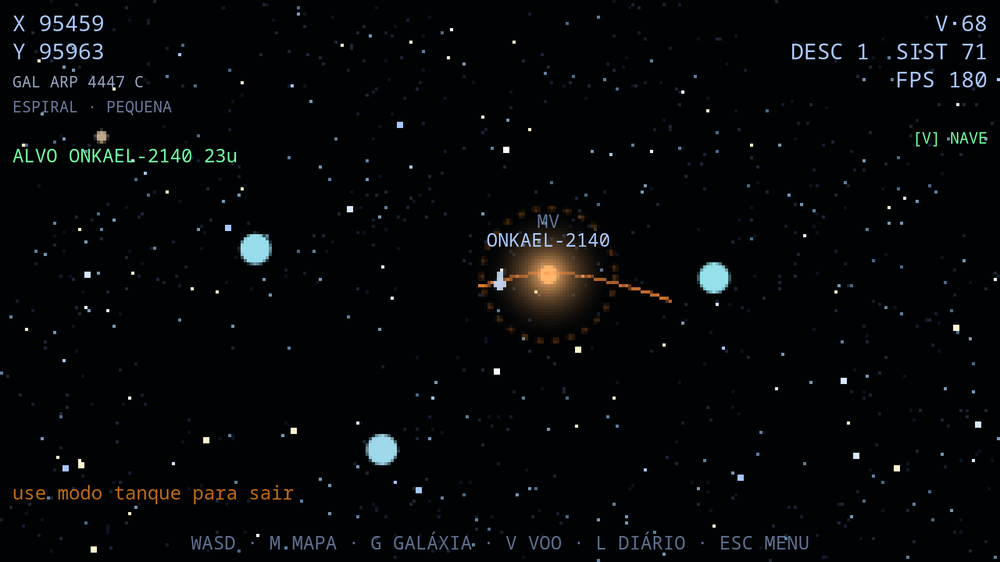

*[Read in English](README.md)*

# Singularvs

> Um demake 2D de **SpaceEngine**, no espirito de **Elite (1984)** — tudo procedural, zero assets.

**Singularvs** e um simulador espacial contemplativo que roda inteiramente no navegador. Um unico arquivo HTML, sem dependencias, sem imagens, sem audio pre-gravado. Todo o universo -- de bilhoes de galaxias a graos de areia numa praia alienigena -- e gerado ao vivo a partir de funcoes matematicas deterministicas.

---

## O que tem dentro

- **Universo de ~1 Gpc** com bilhoes de galaxias procedurais (espirais, barradas, elipticas, irregulares, lenticulares, quasares).
- **Escala aninhada continua**: mapa galactico -> mapa estelar -> sistema -> telescopio -> orbita -> superficie.
- **Estrelas** com classes espectrais (OBAFGKM + anas marrons L/T), classes de luminosidade, e **sistemas multiplos hierarquicos** de ate 8 estrelas (binarias, ternarias, quaternarias -- com companheiras que podem ser anas marrons, estrelas de neutrons ou buracos negros).
- **Planetas** classificados cientificamente: Terra, Super Terra (Hestia-like), Deserto, Gelo, Titan, Oceania, Selena, Anao, Gigante Gasoso, Gigante de Gelo, Cometas.
- **Simulacao interna**: composicao de crosta/manto/nucleo, calor radiogenico, placas tectonicas (Voronoi simplificado), vulcanismo, cryovulcanismo (Europa/Encelado), cordilheiras, lagos e rios.
- **Atmosferas** com pressao em atm/mmHg, composicao, densidade, efeito estufa.
- **Biologia**: origem (abiogenese vs panspermia), tipo (unicelular/multicelular), habitat (aerea/aquatica/terrestre/todas/subglacial).
- **Luas e aneis** procedurais, visiveis tanto no globo quanto no ceu da superficie.
- **Ceu dinamico** com todas as estrelas do sistema (A, B, C, D...), cor espectral, brilho por fluxo (L/d2), atenuacao atmosferica e ciclo dia/noite.
- **Superficie navegavel** em primeira pessoa, com terreno, rios, vegetacao, estrelas de fundo, mancha vermelha em Terras locked de anas M.
- **Star Browser** com filtros (Terra, Deserto, Gelo, Gas, Cometa) e ordenacao por colunas.
- **Mapa unificado** com zoom continuo entre escala galactica e estelar.
- **Diario de bordo** persistente (localStorage) com batismo de sistemas e anotacoes.
- **Musica procedural** com progressoes modais, pads, baixo, arpejos, kick e voz de lead.
- **Pos-processamento WebGL2**: presets cinematografico, CRT retro, pixel puro.

---

## Como jogar

Nao precisa instalar nada. Nao precisa de servidor. Basta abrir o arquivo no navegador:

    xdg-open index.html      # Linux
    open index.html          # macOS
    start index.html         # Windows

Ou, se quiser servir via HTTP (para testar localStorage em alguns navegadores):

    python3 -m http.server 8000
    # depois acesse http://localhost:8000

Recomendado: **Firefox** ou **Chromium** recentes, com WebGL2 habilitado.

---

## Controles

### Teclado

| Acao | Tecla |
|---|---|
| Voar / girar | WASD ou setas |
| Modo de voo | V |
| Focar sistema | ENTER (perto) |
| Soltar foco | ESC |
| Telescopio | T |
| Info do planeta | I |
| Pousar | ENTER (em orbita) |
| Mapa estelar | M |
| Mapa galactico | G |
| Zoom no mapa | Q / E / roda do mouse |
| Diario de bordo | L |
| Star Browser | B |
| Batizar / Nota | N / J |
| Pos-processamento | F2 |
| Captura de tela | F4 |
| Menu | ESC |

### Gamepad (XInput / GameSir T4)

| Acao | Botao |
|---|---|
| Voar / girar | Analogo esquerdo |
| Turbo | RT / LT |
| Modo de voo | L3 / R3 |
| Focar / pousar | A |
| Voltar / soltar | B |
| Telescopio | X |
| Info do planeta | R3 |
| Mapa estelar | Y |
| Mapa galactico | LB |
| Diario | RB |
| Zoom no mapa | LT / RT |
| Menu | START |

Ha um **Guia de Controles** completo no proprio menu do jogo.

---

## Destaques tecnicos

- **Um unico arquivo** de ~320 KB, sem minificacao, sem build step.
- **Zero dependencias**: nenhum framework, nenhuma biblioteca. Apenas Canvas 2D, WebGL2 e Web Audio -- APIs nativas do navegador.
- **Zero assets**: nenhuma imagem, nenhum som, nenhuma fonte embutida. Toda estetica e matematica.
- **Geracao on-demand**: nada do universo e armazenado. Cada galaxia, estrela, planeta e feature e recalculado por hash a partir de coordenadas inteiras. A "semente" (seed) e o unico dado persistido do universo.
- **PRNG deterministico** (mulberry32) e hashes espaciais (hash2D) garantem reprodutibilidade absoluta: a mesma seed produz o mesmo universo, para sempre.
- **Camadas de LOD** para o mapa estelar: stipple em world space com jitter deterministico, evitando moire e flicker em zoom continuo.

---

## Inspiracoes e creditos

Este e um projeto de fa, **sem fins comerciais**, feito por pura vontade de criar.

- **SpaceEngine** (Vladimir Romanyuk / CosmoGraphic) -- inspiracao conceitual e estetica para classificacao planetaria, terminologia e estrutura de dados.
- **Elite** (David Braben e Ian Bell, 1984) -- inspiracao na filosofia de geracao procedural sem assets, tudo on-demand em memoria.
- **Kurzgesagt - In a Nutshell** -- referencias cientificas conceituais (Super Terras tipo Hestia, cryovulcanismo, panspermia).

Nenhum codigo, asset, dado ou metadado desses projetos foi utilizado. Todo o conteudo e original e gerado proceduralmente. O nome "SpaceEngine" nao e usado como marca deste projeto.

---

## Desenvolvimento

Este projeto foi desenvolvido em colaboracao humano-IA. Veja CONTRIBUTORS.md para detalhes sobre o processo criativo e as ferramentas utilizadas.

---

## Licenca

Distribuido sob a **Licenca MIT**. Veja LICENSE para o texto completo.

Em resumo: voce pode usar, copiar, modificar, fundir, publicar, distribuir, sublicenciar e/ou vender copias deste software, desde que mantenha o aviso de copyright original e a licenca MIT em todas as copias ou partes substanciais.
